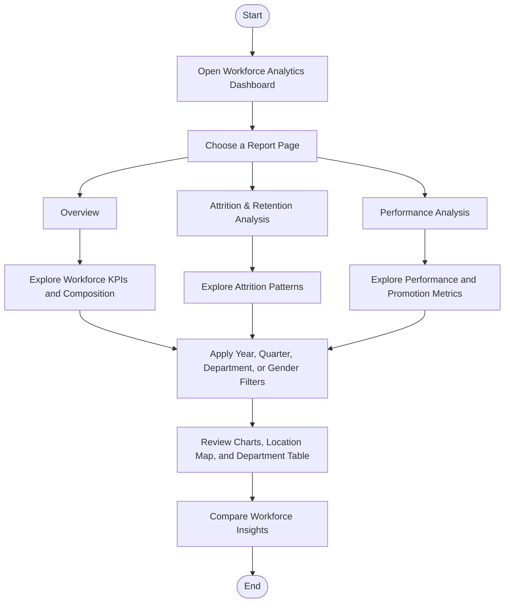
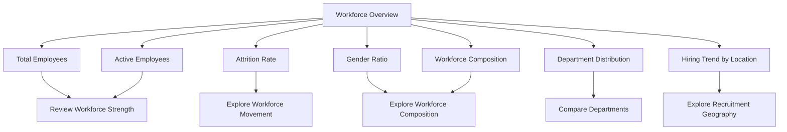
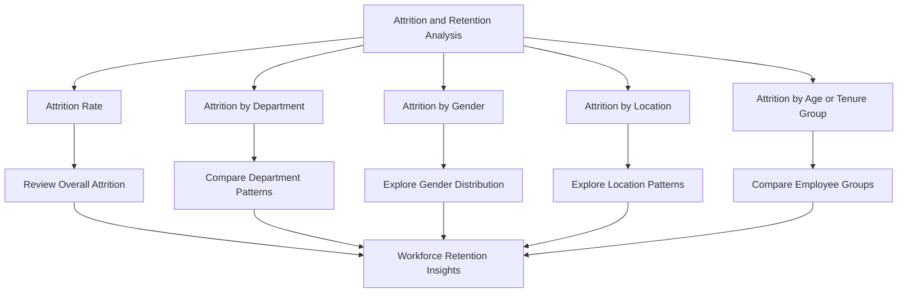
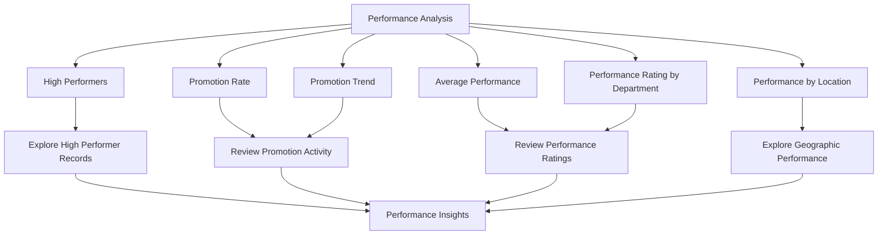
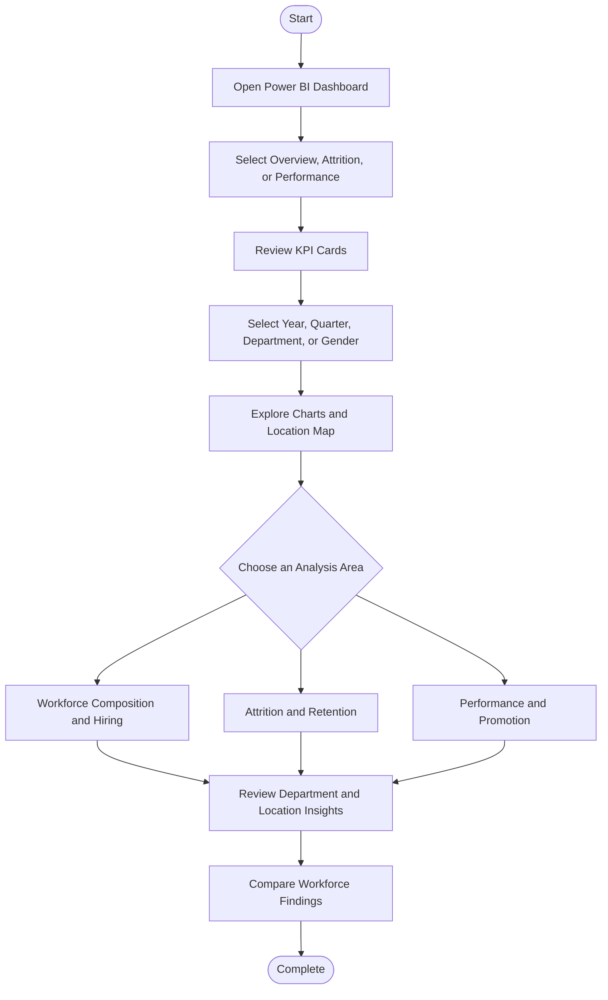

# Accenture India Workforce Analytics Dashboard

An interactive Power BI dashboard for exploring workforce composition, employee attrition and retention, recruitment activity, and employee performance across departments and locations.

## Project Overview

The **Accenture India Workforce Analytics Dashboard** brings key HR metrics into one interactive report. It helps users explore employee strength, workforce composition, attrition patterns, hiring activity, performance ratings, and promotion trends.

The report is organized into three focused pages:

1. **Overview**
2. **Attrition & Retention Analysis**
3. **Performance Analysis**

Each page combines KPI cards, charts, geographic visualizations, detailed tables, and interactive slicers to support workforce analysis.

## Dashboard at a Glance

| Report Page | Main Focus | Key Analysis |
|---|---|---|
| Overview | Workforce summary | Total employees, active employees, attrition rate, gender ratio, department distribution, workforce composition, hiring trend |
| Attrition & Retention Analysis | Employee attrition | Attrition by department, gender, location, and age or tenure group |
| Performance Analysis | Employee performance | High performers, promotion rate, average performance, department ratings, promotion trend, and location performance |

## Dashboard Navigation Flowchart



## Page 1: Overview

The Overview page provides a consolidated view of workforce strength, employee composition, department distribution, and hiring activity.

### Key Performance Indicators

| KPI | Report Field / Measure | Business Purpose |
|---|---|---|
| Active Employees | Count of `FactWorkforce[IsActive]` records | Shows active workforce records |
| Gender Ratio | `DimDate[Gender Ratio]` measure | Presents the workforce gender ratio |
| Total Employees | `DimDate[Total Employees]` measure | Shows overall employee strength |
| Attrition Rate | `DimDate[Attrition Rate]` measure | Tracks the employee attrition rate |

### Visualizations

| Visualization | Chart Type | Fields Used | Purpose |
|---|---|---|---|
| Employee Distribution by Department | Clustered column chart | `DepartmentName`, Employee ID count | Compares employee distribution across departments |
| Workforce Composition | Donut chart | `Gender`, Employee ID count | Shows workforce composition by gender |
| Hiring Trend | Shape map | `City`, `LocationID`, Candidate ID count | Presents recruitment activity geographically |
| Department Summary | Table | Department Name, Total Employees, Attrition Rate, Base Salary | Provides department-level workforce and compensation details |

### Interactive Filters

| Slicer | Field | Usage |
|---|---|---|
| Year | `DimDate[Year]` | Explore workforce information by year |
| Quarter | `DimDate[Quarter]` | Focus on a selected quarter |
| Department | `DimDepartment[DepartmentName]` | Explore a department |
| Gender | `DimEmployee[Gender]` | Explore workforce information by gender |

### Overview Analysis Flow



## Page 2: Attrition & Retention Analysis

This page provides a focused view of employee attrition across departments, gender groups, locations, and age or tenure groupings.

### Key Performance Indicators

| KPI | Report Field / Measure | Business Purpose |
|---|---|---|
| Gender Ratio | `DimDate[Gender Ratio]` measure | Presents workforce gender ratio |
| Total Employees | `DimDate[Total Employees]` measure | Shows overall employee strength |
| Attrition Rate | `DimDate[Attrition Rate]` measure | Tracks employee attrition rate |
| Active Employees | Count of `FactWorkforce[IsActive]` records | Shows active workforce records |

### Visualizations

| Visualization | Chart Type | Fields Used | Purpose |
|---|---|---|---|
| Attrition by Department | Clustered bar chart | `DepartmentName`, Attrition Count | Compares attrition across departments |
| Attrition by Gender | Donut chart | `Gender`, Attrition Count | Shows attrition distribution by gender |
| Attrition by Location | Shape map | `City`, `LocationID`, Attrition Count | Presents attrition geographically |
| Attrition by Age Group | Clustered column chart | `Tenure Group`, Attrition Count | Compares attrition across the report's tenure groups |
| Department Summary | Table | Department Name, Total Employees, Attrition Rate, Base Salary | Provides department-level workforce and compensation details |

### Interactive Filters

| Slicer | Field | Usage |
|---|---|---|
| Year | `DimDate[Year]` | Explore attrition by year |
| Quarter | `DimDate[Quarter]` | Focus on a selected quarter |
| Department | `DimDepartment[DepartmentName]` | Explore a department |
| Gender | `DimEmployee[Gender]` | Explore attrition by gender |

### Attrition Analysis Flow



## Page 3: Performance Analysis

The Performance Analysis page focuses on high performers, promotion activity, performance ratings across departments, and geographic performance.

### Key Performance Indicators

| KPI | Report Field / Measure | Business Purpose |
|---|---|---|
| Gender Ratio | `DimDate[Gender Ratio]` measure | Presents workforce gender ratio |
| High Performers | Count of `FactPerformance[HighPerformerFlag]` records | Highlights high-performer records |
| Promotion Rate | Count of `FactPerformance[PromotedFlag]` records | Presents promotion-related records |
| Avg Performance | `FactPerformance[PerformanceRating]` aggregation | Summarizes employee performance ratings |

### Visualizations

| Visualization | Chart Type | Fields Used | Purpose |
|---|---|---|---|
| Performance Rating Distribution | Clustered column chart | `DepartmentName`, Performance Rating | Compares performance ratings across departments |
| Promotion Trend | Line chart | Performance Rating, Employee ID count, Gender distinction | Explores employee counts across performance rating levels |
| Performance by Location | Shape map | `City`, `LocationID`, Performance Rating | Presents performance geographically |
| Department Summary | Table | Department Name, Total Employees, Attrition Rate, Base Salary | Provides department-level workforce and compensation details |

### Interactive Filters

| Slicer | Field | Usage |
|---|---|---|
| Year | `DimDate[Year]` | Explore performance by year |
| Quarter | `DimDate[Quarter]` | Focus on a selected quarter |
| Department | `DimDepartment[DepartmentName]` | Explore a department |
| Gender | `DimEmployee[Gender]` | Explore performance by gender |

### Performance Analysis Flow



## Data Model

The report references the following model tables:

| Table | Role in the Dashboard |
|---|---|
| `DimDate` | Date attributes and workforce measures |
| `DimDepartment` | Department information |
| `DimEmployee` | Employee attributes, including gender |
| `DimLocation` | City and location information |
| `FactWorkforce` | Workforce activity and tenure grouping |
| `FactRecruitment` | Recruitment and candidate information |
| `FactCompensation` | Employee compensation information |
| `FactPerformance` | Performance, high-performer, and promotion information |

### Main Fields and Measures

| Field / Measure | Table | Dashboard Usage |
|---|---|---|
| `Total Employees` | `DimDate` | Employee strength KPI and department summary |
| `Active Employees` / `IsActive` | `FactWorkforce` | Active workforce KPI |
| `Attrition Rate` | `DimDate` | Attrition KPI and department summary |
| `Attrition Count` | `DimDate` | Attrition charts |
| `Gender Ratio` | `DimDate` | Gender ratio KPI |
| `EmployeeID` | `DimEmployee` / `FactRecruitment` | Employee counts and workforce analysis |
| `Gender` | `DimEmployee` | Workforce composition and gender analysis |
| `DepartmentName` | `DimDepartment` | Department comparisons and filtering |
| `City` | `DimLocation` | Geographic visualizations |
| `CandidateID` | `FactRecruitment` | Hiring trend |
| `Tenure Group` | `FactWorkforce` | Attrition group analysis |
| `BaseSalary` | `FactCompensation` | Department summary |
| `HighPerformerFlag` | `FactPerformance` | High Performers KPI |
| `PromotedFlag` | `FactPerformance` | Promotion Rate KPI |
| `PerformanceRating` | `FactPerformance` | Performance KPI and charts |
| `Year`, `Quarter` | `DimDate` | Time-based filtering |

## End-to-End Workforce Analysis Workflow



## Visualization Guide

| Visualization | Best Use | Dashboard Application |
|---|---|---|
| KPI Card | Highlighting an important business metric | Total Employees, Attrition Rate, High Performers, Promotion Rate |
| KPI Visual | Showing a key indicator with a trend or category | Active Employees, Gender Ratio, Avg Performance |
| Clustered Column Chart | Comparing values across categories | Employee Distribution, Attrition by Age Group, Performance Rating |
| Clustered Bar Chart | Comparing categories horizontally | Attrition by Department |
| Donut Chart | Showing category composition | Workforce Composition and Attrition by Gender |
| Line Chart | Exploring patterns across ordered values | Promotion Trend |
| Shape Map | Presenting geographic information | Hiring, Attrition, and Performance by Location |
| Table | Displaying detailed department information | Department Summary |
| Slicer | Interactive report filtering | Year, Quarter, Department, and Gender |

## Business Questions Explored

The dashboard supports exploration of questions such as:

1. How many employees are represented in the workforce?
2. How many active employees are recorded?
3. What is the overall attrition rate?
4. How is the workforce distributed across departments?
5. What is the gender composition of the workforce?
6. How is recruitment activity distributed by location?
7. How does attrition vary across departments?
8. How is attrition distributed by gender?
9. Which locations show different attrition patterns?
10. How does attrition vary across tenure groups?
11. How many high-performer records are represented?
12. What is the promotion rate shown in the report?
13. How do performance ratings compare across departments?
14. How do performance patterns vary by location?

## How to Use the Dashboard

1. Open `pr_4.pbix` in Microsoft Power BI Desktop.
2. Select **Overview** to explore workforce composition and hiring activity.
3. Select **Attrition & Retention Analysis** to explore employee attrition patterns.
4. Select **Performance Analysis** to explore performance and promotion information.
5. Use the Year, Quarter, Department, and Gender slicers to focus the analysis.
6. Explore the charts, maps, and department summary table.
7. Select chart elements to explore related information across the report.
8. Change the slicers to compare different workforce segments and reporting periods.

## Project Structure

```text
Accenture-India-Workforce-Analytics/
│
├── pr_4.pbix
└── README.md
```

## Tools and Technologies

| Tool / Technology | Purpose |
|---|---|
| Microsoft Power BI Desktop | Dashboard development and reporting |
| Power BI KPI Visuals | Workforce and performance indicators |
| Power BI Charts | Department, gender, attrition, and performance analysis |
| Power BI Shape Map | Geographic workforce analysis |
| Power BI Tables | Department-level details |
| Power BI Slicers | Interactive filtering |
| Mermaid | Flowcharts and workflow diagrams |
| Markdown | Project documentation |

## Project Summary

The **Accenture India Workforce Analytics Dashboard** combines workforce overview, attrition and retention analysis, and employee performance analysis in one interactive Power BI report.

Its three pages provide focused views of employee strength, active workforce, gender composition, recruitment activity, attrition patterns, high performers, promotion activity, and performance by department and location. KPI visuals, charts, maps, tables, and interactive slicers make it easy to explore workforce insights from multiple perspectives.

---

**Project Name:** Accenture India Workforce Analytics Dashboard  
**Power BI File:** `pr_4.pbix`  
**Documentation File:** `README.md`
